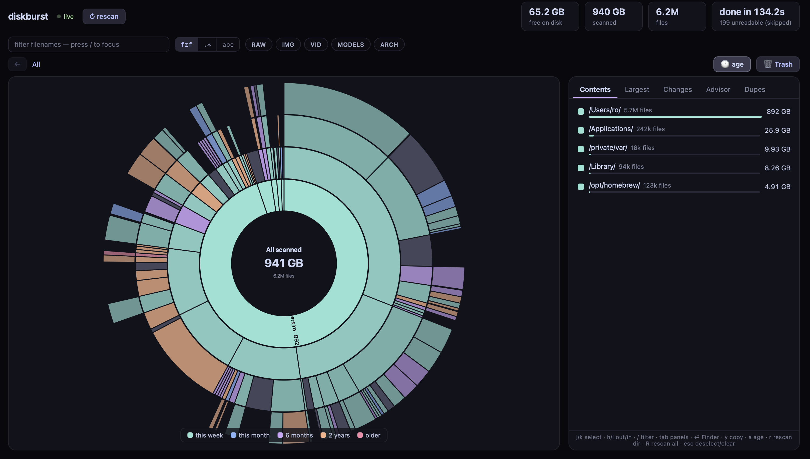

# diskburst

 Quick macOS disk usage visualizer with UI largely inspired by DaisyDisk, but free, open source and designed to fix my needs; I primarly wanted this to tackle finding and cleaning up scattered model checkpoints, duplicate large files and old items I no longer need. Features like search fzf, age colormap, etc are built around this.

Served on localhost, and written in python. I found syscall as the bottleneck and minimal speedup with C, with complexity not justifying increased speed when full disk scan; and targeted rescan or events caught by live change monitor (FSEvents) being fast.

Code is AI-gen; more-so than my usual work; subsequently I was only happy with this being read only (though could add trash), and it links to finder for manual deletion. PRs/Issues welcome.



## Quick start

```sh
uv sync                              # installs watchdog (live mode) + dev tools
uv run python -m diskburst           # http://127.0.0.1:8890
```

Or with no environment at all — the stdlib is enough to run everything except
live mode: `python3 -m diskburst`. Default scan roots:
`~`, `/Applications`, `/Library`, `/opt/homebrew`, `/private/var`.

```
--config PATH           TOML config file (default ~/.config/diskburst/config.toml)
--roots DIR [DIR ...]   directories to scan
--port N                default 8890
--workers N             scan threads, default 48 (syscall-bound; threads release the GIL)
--min-file-mb N         retain individual files ≥ N MB (smaller ones still count in totals)
--no-cache              ignore the saved snapshot; scan fresh
--no-live               disable FSEvents live updates
```

Persistent settings go in `~/.config/diskburst/config.toml` (see
`config.example.toml`); CLI flags override the file.

## What you get

- **Sunburst** — click to zoom, center to go up, hover raises the branch.
  Hue marks the top-level branch (home pinned blue, `Library` mauve); deeper
  rings recede toward the surface. Catppuccin Mocha on a near-black ground.
- **Contents / Largest** — TreeSize-style drill-down and the top files within
  the current zoom, with copy-path and reveal-in-Finder on every row.
- **Changes** — diff against the previous (or oldest) snapshot: what grew,
  what shrank, new and removed subtrees, small-file churn per directory.
- **Advisor** — recognizes known reclaimable locations (uv, Hugging Face, pip,
  npm, ollama, Homebrew, Xcode DerivedData, Docker, conda, `node_modules`, …)
  and shows each one's official clean command.
- **Dupes** — probable duplicates among files ≥ 50 MB via exact size +
  head/tail SHA-256 fingerprint, with on-demand full-file SHA-256
  verification and suggested `rm && ln -s` dedupe commands.
- **Filter** — the same map with sizes restricted to matching files: preset
  filetype chips (RAW / IMG / VID / MODELS / ARCH), or your own query as
  fzf-style fuzzy, regex, or plain substring (`/` to focus, Esc to clear).
  Filters see retained files (≥ `min_file_mb`, default 1 MB).
- **Age lens** — recolor by last-modified age (this week → 2 years+); old and
  big is where the safe deletions live.
- **Live mode** — FSEvents keeps sizes current between scans. Best-effort by
  design: high-churn system paths are deny-listed and overload is dropped;
  the next full rescan is always authoritative.

## Keyboard

```
j / k       select row            g / G     first / last
h / l       zoom out / in         (selection follows, so h and l chain)
/           focus filter          Tab       cycle panels
Esc         deselect, then clear filter
Enter       reveal in Finder      y         copy path
r           rescan this dir       R         rescan everything
a           age lens
```

## How it works

`scanner.py` walks with `os.scandir` on a worker pool — allocated blocks
(`st_blocks × 512`, what you'd actually free), hardlinks counted once,
symlinks never followed, mount points never crossed. The tree stays queryable
mid-scan; totals refresh every 2 s. Completed scans persist to
`~/.cache/diskburst/` (gzipped JSON, ~6 MB per million dirs); on
restart the snapshot serves immediately while a fresh scan runs behind it and
swaps in atomically. Snapshot history (last 5) backs the Changes diff.
`server.py` is a stdlib `ThreadingHTTPServer` bound to `127.0.0.1` serving
JSON endpoints (`/api/tree`, `/api/largest`, `/api/diff`, `/api/advisor`,
`/api/duplicates`, `/api/status`, rescan and cancel); the frontend is a
single hand-rolled SVG sunburst — no frameworks, no CDNs, no telemetry.

## Tests

```sh
uv run pytest
```

Synthetic KB-scale fixtures; no network, no large files.
